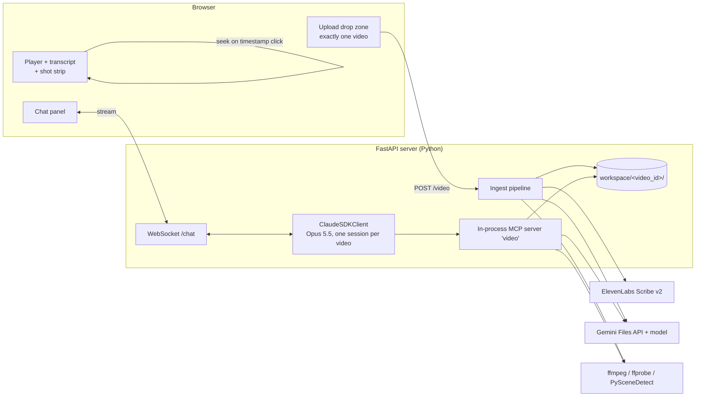

# Video Agent Harness: Design (brainstorm)

Status: draft for discussion, 2026-10-18. Nothing is scaffolded yet.

## 1. Goal

A local web app where the user uploads **one video** and chats with an agent about it. The agent answers questions with timestamps it can back up, finds moments, and (in a later phase) edits the video.

| Concern | Provider |
|---|---|
| Speech to text | ElevenLabs Scribe v2 |
| Visual and multimodal understanding | Gemini (Files API and video input) |
| Orchestration, planning and tool use | Claude Agent SDK (the Claude Code engine) on Opus 5.5 |

The harness builds on `~/code/VideoAgent`, a clone of HKUDS/VideoAgent at `f207987`. It keeps that project's tool library and drops its planner. Section 7 covers what is reused.

## 2. What we learned

### From VideoAgent (HKUDS)

**Pipeline:** `MultiAgent` (`environment/agents/multi.py`) works in four steps:
1. An LLM picks intents from `intents.yml`.
2. It narrows the tool registry to those intents.
3. It asks Claude for a JSON "agent graph" (`config/graph.txt`) and has a second prompt judge it.
4. It runs the chain.

**Tools:** each tool is a `BaseTool` with pydantic `InputSchema` and `OutputSchema`, auto-registered from `environment/roles`.

**Weaknesses for our purposes:**
- **Planning:** it plans the whole graph once, up front, with no tool-result feedback loop. Claude Code's agent loop replaces this.
- **File passing:** tools pass data through fixed paths under `dataset/`, such as `dataset/video_edit/scene_output/video_scene.json`. This makes them hard to compose. We need one workspace per video.
- **Heavy local models:** Whisper large-v3-turbo, CosyVoice, seed-vc, ImageBind, VideoRAG and fish-speech need CUDA and many GB of weights. ElevenLabs replaces Whisper, and Gemini replaces ImageBind and VideoRAG captioning for a single video.
- **Q&A:** `VideoContentQA` stuffs the transcript into a prompt. It never looks at the frames again.

**Worth keeping:**
- **Tool contract:** the typed tool contract (pydantic schema → description) maps one-to-one onto MCP tools.
- **Audio and editing roles:** AudioExtractor, Separator, LoudnessNormalizer, Mixer, Merge and VideoEditor.
- **Recipes:** the intent → tool-chain recipes in `intents.yml`. These become Skills.

### From Yichi's other repos
- **`~/code/video-rag`:** a Postgres + pgvector knowledge graph over caption and transcript chunks. It is useful if we ever go multi-video, but it is overkill for one video.
- **`~/code/agent-harness`:**
  - Patterns to reuse directly: versioned `release.json`, a Langfuse trace per run, guardrails (`max_steps`, `max_cost_usd`, approval gates), and an LLM-judge eval gate.
  - Section 9 reuses these.

### From comparable projects
- **Deep Video Discovery (Microsoft, 2025)** is the closest match. It indexes once into 5-second clip captions plus a subject registry. A ReAct agent then uses three coarse-to-fine tools: Global Browse, Clip Search and Frame Inspect. Our design is DVD with Claude as the planner and Gemini behind Frame Inspect.
- **OmAgent's "Rewinder"** shows the agent always needs a path back to the raw pixels, because captions lose detail.
- **Stanford VideoAgent** uses a self-confidence gate: answer, rate confidence, and look again only if unsure. This keeps Gemini calls down.
- **Descript Underlord** treats the word-level transcript as the editing surface. Cuts snap to word boundaries, which maps directly onto Scribe word timestamps.
- **mcp-video / Kinocut, OpenMontage and ChatCut** share three patterns:
  - FFmpeg is exposed as typed, validated tools, never raw shell.
  - An edit decision list (EDL) is the source of truth, and the renderer is deterministic.
  - The agent proposes before it commits, and it writes a render receipt.
- **Twelve Labs Pegasus** asks the vision model for timestamped JSON against a schema, not prose.

## 3. Architecture



**Single-process server.** One FastAPI app holds:
- the upload endpoint;
- the ingest job;
- one long-lived `ClaudeSDKClient` per video;
- a WebSocket that relays SDK stream events to the browser.

**Why Python rather than TypeScript:** VideoAgent's tools, PySceneDetect and the ffmpeg wrappers are Python, and `claude-agent-sdk` for Python has in-process MCP tools (`@tool` + `create_sdk_mcp_server`). The front end is a separate Vite + React app.

## 4. Ingest pipeline (runs once on upload)

The UI accepts one file. Uploading a new one replaces the current video and starts a fresh chat session. Steps 2–5 run in parallel, and the UI shows each one's progress.

| # | Step | Output in `workspace/<id>/` |
|---|---|---|
| 1 | Save original. Run `ffprobe` for duration, fps, resolution and audio streams. Reject the upload if it is over the length cap (see open questions). | `source.mp4`, `meta.json` |
| 2 | Make a 720p H.264 proxy plus a keyframe thumbnail strip, used by the UI and by `get_frames`. | `proxy.mp4`, `thumbs/` |
| 3 | **ElevenLabs:** send the video file straight to `POST /v1/speech-to-text` with `model_id=scribe_v2`, `diarize=true`, `tag_audio_events=true`, `timestamps_granularity=word`, and language auto-detect. Group the words into sentence-level segments. | `transcript.json` (words + segments + speakers) |
| 4 | **Shot detection:** PySceneDetect ContentDetector. Merge shots under 1 s, and split shots over 30 s. | `shots.json` |
| 5 | **Gemini:**<br>• Upload with `client.files.upload` and poll until `ACTIVE`.<br>• Run one pass that returns schema-constrained JSON: a caption, on-screen text, people/objects and an action for each shot, plus a global summary and a subject registry of recurring people and things.<br>• Feed shot boundaries and transcript segments into the prompt so the captions line up with them. | `gemini_file.json` (uri, expiry), `captions.json`, `overview.json` |
| 6 | Build a small search index: BM25 over transcript segments and captions. Embeddings are optional, and SQLite FTS5 is enough for one video. | `index.sqlite` |

**Gemini Files API:** files expire after 48 h. The tool layer re-uploads the file on demand when `gemini_file.json` is stale.

**Cost** for a 10-minute video, at Oct-2026 list prices:
- Scribe: about $0.04.
- One full Gemini 3.8 Flash (`gemini-3.8-flash`) pass at high media resolution (about 180k tokens): about $0.14 input, rising to about $0.27 when Flash's price doubles on 2027-01-01. A 60-minute video is about six times that.

## 5. Agent design (Claude Agent SDK)

```python
options = ClaudeAgentOptions(
    model="claude-opus-5-5",
    cwd=f"workspace/{video_id}",
    system_prompt=VIDEO_AGENT_PROMPT,          # versioned file, like agent-harness
    mcp_servers={"video": video_server},
    tools=["Skill"],                           # the only built-in tool
    allowed_tools=["mcp__video__*"],
    disallowed_tools=["Bash", "WebFetch", "WebSearch"],
    permission_mode="dontAsk",                 # anything not allowed is denied, never prompts
    include_partial_messages=True,             # token streaming to the UI
    max_budget_usd=2.00,
    plugins=[{"type": "local", "path": "server/agent/plugin"}],  # the Skills
    skills=["video:summarize-video", "video:find-moments"],
    setting_sources=[],                        # no CLAUDE.md or settings from the repo or user
)
```

### Tools (MCP server `video`), from coarse to fine

| Tool | What it does | Backed by |
|---|---|---|
| `get_overview()` | Duration, speakers, global summary, subject registry, shot count | `overview.json` |
| `search(query, k)` | Hits over transcript and captions, each with `[start,end]`, shot id and snippet | `index.sqlite` |
| `get_transcript(start, end)` | Words or segments in a range, with speakers | `transcript.json` |
| `list_shots(start?, end?)` | Shot boundaries and captions | `shots.json`, `captions.json` |
| `inspect(question, start, end, fps?)` | Asks Gemini a focused question about a time range (`start_offset`/`end_offset`, higher fps for fast action). Returns JSON with timestamps. | Gemini |
| `get_frames(timestamps[])` | Returns JPEG frames as image blocks, so Claude can see them directly | ffmpeg on the proxy |

**Phase 2: editing tools.** These change the EDL, never the source file:
- `edl_get()`
- `edl_apply(ops[])`: keep, cut, reorder, caption, overlay and audio ops. Cuts snap to word boundaries.
- `render_preview()`: low resolution, fast.
- `export()`: full quality. Writes a render receipt containing the EDL hash, ffprobe output and duration.

Later phases wrap the VideoAgent audio roles as tools as well:
- `separate_vocals`
- `normalize_loudness`
- `add_bgm`

### Grounding rule (in the system prompt)

- **Timestamps:** every factual claim about the video carries a `[mm:ss]` or `[mm:ss–mm:ss]` that came from a tool result.
- **When to inspect:** if transcript and captions don't settle a question, call `inspect` or `get_frames` before answering, rather than guessing. This follows the Stanford VideoAgent and OmAgent pattern.
- **UI:** it renders the timestamps as chips that seek the player.

### Skills

Skills replace VideoAgent's `intents.yml` recipes. They are markdown under `server/agent/plugin/skills/`, shipped as a local plugin named `video`. A plugin needs no `setting_sources`, so the repo's own `CLAUDE.md` and `.claude/` settings (which are for developers, not the agent) never reach it. For example:
- `summarize-video`
- `find-moments`
- `highlight-reel`
- `podcast-cleanup` (filler and silence removal)
- `make-captions`

Claude loads one only when the request needs it.

### Subagents

Off for v1. One Opus loop is enough for a single video, and Opus delegates eagerly. If needed, a `frame-analyst` subagent on Sonnet could batch many `inspect` calls.

### Sessions

- One SDK session per chat, and a video can have several chats. Each chat stores its `session_id` in `workspace/<id>/chats/<chat_id>/session.json` so a reload resumes the conversation with `resume=`.
- A new upload starts a new session.

## 6. UI

```
┌──────────────────────────────────────────┬──────────────────────────┐
│  [ Drop one video here / Replace ]       │  Chat                    │
│  ┌────────────────────────────────────┐  │  ┌────────────────────┐  │
│  │            video player            │  │  │ user / agent turns │  │
│  └────────────────────────────────────┘  │  │ [01:23] chips seek │  │
│  shot strip (thumbnails, click = seek)   │  │ ▸ tool calls (fold)│  │
│  transcript (speaker-colored, synced,    │  └────────────────────┘  │
│  click word = seek; highlights = hits)   │  [ message… ]  [Stop]    │
└──────────────────────────────────────────┴──────────────────────────┘
```

**Upload:**
- It accepts a single file, with no multi-select.
- Replacing the video asks for confirmation, because it resets the chat.
- The upload goes in chunks with a progress bar.
- Each ingest step shows its own status.

**Chat:**
- **Before ingest finishes:** chat is disabled until the transcript and overview exist. Captions can keep running in the background, and tools that need them say so.
- **Streaming:** the reply streams token by token from `StreamEvent` `text_delta`.
- **Tool calls:** they appear as folded rows ("Searched transcript for 'pricing'", "Asked Gemini about 03:10–03:40").
- **Stop:** the Stop button calls `client.interrupt()`.
- **Phase 2:** an EDL timeline under the player shows proposed cuts before render, with Accept and Undo.

**Stack:** Vite + React + Tailwind. The player is a plain `<video>` element using the proxy. Transport is one WebSocket per tab carrying JSON frames: `user_message`, `stream_event`, `tool_use`, `tool_result`, `result`, `ingest_status` and `error`.

## 7. What we take from VideoAgent

| VideoAgent piece | Decision |
|---|---|
| `MultiAgent` intent → graph → judge planner | **Drop.** Claude's agent loop plans, observes results and re-plans. |
| `BaseTool` pydantic schemas plus `FunctionRegistry` | **Keep the idea.** Add a small adapter that turns a `BaseTool` subclass into an MCP `@tool`, so existing roles plug in without rewrites. |
| `intents.yml` recipes | **Convert to Skills** (markdown). |
| `AudioExtractor`, `Separator`, `LoudnessNormalizer`, `Mixer`, `Merge` | **Reuse in phase 2–3**, after making paths workspace-relative. |
| `VideoEditor`, `VideoPreloader`, `VideoSearcher` (VideoRAG + ImageBind) | **Replace.** Search uses our index. `inspect` uses Gemini. Editing uses EDL + ffmpeg. |
| `Transcriber` and the Whisper in `VideoContentQA` | **Replace** with ElevenLabs. |
| TTS, SVC, stand-up and cross-talk (CosyVoice, seed-vc, DiffSinger, fish-speech) | **Out of scope for v1.** If voice-over comes back, use ElevenLabs TTS rather than local models. |

**How to reuse:** copy the few roles we need into `harness/tools/legacy/` with attribution (VideoAgent is MIT). Depending on the whole repo would pull in its CUDA and `tools/` requirements.

## 8. Proposed repo layout

```
video-agent-harness/
  DESIGN.md
  server/                 FastAPI app
    app.py                routes: POST /video, GET /video/{id}/..., WS /chat
    ingest/               probe.py, proxy.py, scribe.py, shots.py, gemini_index.py, index.py
    agent/                session.py (ClaudeSDKClient lifecycle), prompt.v*.md, tools.py (MCP server),
                          plugin/skills/ (summarize-video, find-moments, ...)
    edl/                  schema.py, render.py (ffmpeg)            # phase 2
    legacy/               adapted VideoAgent roles + BaseTool→MCP adapter
  web/                    Vite + React UI
  workspace/              per-video data (gitignored)
  evals/                  question set + judge (from agent-harness)
  release.json            model ids, prompt version, budgets
```

## 9. Guardrails, observability, evals

- **Limits:**
  - SDK level: `max_budget_usd` and `max_turns`.
  - Server level: a per-video cap on Gemini calls, with every `inspect` call cached by (range, fps, question hash).
- **Permissions:** `permission_mode="dontAsk"` with an explicit allowlist. The agent cannot run shell commands. `export` is the only tool that writes outside `workspace/<id>/edl/`.
- **Tracing:** one Langfuse trace per chat turn, as in agent-harness, covering SDK messages, tool calls, Gemini and ElevenLabs latency, and cost.
- **Evals:**
  - About 30 Q&A items over 3–4 reference videos, each with a known answer and timestamp.
  - Scoring has two parts: a code check that the cited timestamp is within ±3 s, and a Haiku judge for answer quality.
  - Gate on both, like `harness eval`.

## 10. Phases

1. **v1, Q&A:** upload, ingest, chat with the read-only tools, timestamp chips, session resume, and evals.
2. **v2, edits:** EDL tools, timeline UI, preview and export, transcript-driven cuts, and burned-in captions.
3. **v3, audio:** VideoAgent audio roles (separation, loudness, BGM), plus optional ElevenLabs TTS voice-over and dubbing.

## 11. Decisions (Yichi, 2026-10-18)

- **Where it runs:** local, single-user demo.
- **v1 scope:** Q&A only. Editing (phase 2) and audio (phase 3) stay on the roadmap but are out of v1.
- **Length cap:** 60 minutes, rejected at upload by ffprobe.
- **Language:** mainly English.
- **Claude auth:** use `ANTHROPIC_API_KEY` when it is set. Otherwise fall back to the local Claude Code login, which uses the subscription. `max_budget_usd` applies only to API billing.
- **Build order:** agent first. Milestone 1 is a CLI chat (see PLAN.md), and every step has an e2e test.
- **Gemini model:** `gemini-3.8-flash` for everything (ingest captions, overview and `inspect`), with no escalation logic. It is the model Google's video docs use in their examples and supports agentic video processing, clipping and fps control.
  - It lives in `release.json` as `gemini_model`, not hard-coded. If `inspect` answers on hard questions (small on-screen text, fast action, counting) look weak in evals, switch it to `gemini-4-argon` (about 2.7× the price).
  - Caching: Flash supports explicit context caching, so the video can be cached once per session and repeat `inspect` calls read it at $0.075 per 1M tokens. Explicit caching goes through `generateContent` with `cached_content`, not the Interactions API.
  - Superseded: Yichi first picked `gemini-4-argon` for everything, then switched to Flash on cost (2026-10-18).
- **Persistence:** one video at a time; a new upload replaces the current video, and its chats are kept for when it is uploaded again.
- **VideoAgent code in v1:** none imported. Every v1 tool (Scribe, shots, Gemini, search, frames) is new code. VideoAgent's reusable roles are all audio and editing, so the `BaseTool` → MCP adapter and `server/legacy/` arrive with phase 2.

## Open questions (original, now answered above)

1. **Where it runs.** Local only on your Mac, or deployed for other people? If it is just you, local single-user is simplest. If others will use it, Anthropic's terms require API-key auth, not a Claude subscription login.
2. **Claude auth for local use.** Use an `ANTHROPIC_API_KEY`, or your Claude Code login? The recommendation is an API key either way, with the SDK's `--bare`-style setup.
3. **v1 scope.** Q&A only, or include basic cuts (trim, remove section, filler removal)?
4. **Video length cap.** A cap of 60 min keeps one Gemini pass in context at high resolution. About 3 h is possible at low resolution.
5. **Gemini model.** The default is `gemini-3.8-flash` for indexing and `inspect`, escalating to `gemini-4-argon` for hard questions. Should the escalation be automatic or a setting?
6. **Language.** Mostly English, or also Chinese, as in VideoAgent's demos? Scribe auto-detects either way, but the prompts and skills would differ.
7. **Persistence.** Keep past videos and chats (a library), or one video at a time with no history?

## 12. Facts to verify before building

These came out of research on 2026-10-18 and should be confirmed against the docs when we scaffold:
- **ElevenLabs file limit:** the docs say both 3 GB and 5 GB. Plan for 3 GB.
- **Gemini per-file limit:** the docs say both 2 GB and 20 GB. Plan for 2 GB.
- **Gemini API surface:** the current docs centre on the Interactions API (`client.interactions.create`, `processing: {fps, start_offset, end_offset}`). Explicit context caching is not available there, so cached `inspect` calls use `generateContent` with `cached_content`. Confirm the `caches.create` call shape for `gemini-3.8-flash`, because the caching page did not show it.
- **SDK tool return values:** Python `@tool` drops `structuredContent`, so tools return JSON as text.

## Sources

- **ElevenLabs STT:**
  - https://elevenlabs.io/docs/capabilities/speech-to-text
  - https://elevenlabs.io/docs/api-reference/speech-to-text/convert
  - https://elevenlabs.io/pricing/api
- **Gemini:**
  - https://ai.google.dev/gemini-api/docs/video-understanding
  - https://ai.google.dev/gemini-api/docs/files
  - https://ai.google.dev/gemini-api/docs/pricing
- **Claude Agent SDK:**
  - https://code.claude.com/docs/en/agent-sdk/overview
  - https://code.claude.com/docs/en/agent-sdk/custom-tools
  - https://code.claude.com/docs/en/agent-sdk/streaming-output
  - https://code.claude.com/docs/en/agent-sdk/permissions
  - https://code.claude.com/docs/en/agent-sdk/sessions
  - https://code.claude.com/docs/en/headless
- **Comparable projects:**
  - Deep Video Discovery: https://arxiv.org/html/2505.18079v4
  - OmAgent: https://arxiv.org/html/2406.16620v2
  - Stanford VideoAgent: https://arxiv.org/html/2403.10517v1
  - HKUDS VideoAgent: https://arxiv.org/pdf/2606.23327
  - mcp-video: https://mcpservers.org/de/servers/kyanitelabs/mcp-video
  - Descript Underlord: https://www.descript.com/agent
  - Twelve Labs Pegasus: https://www.twelvelabs.io/pegasus
