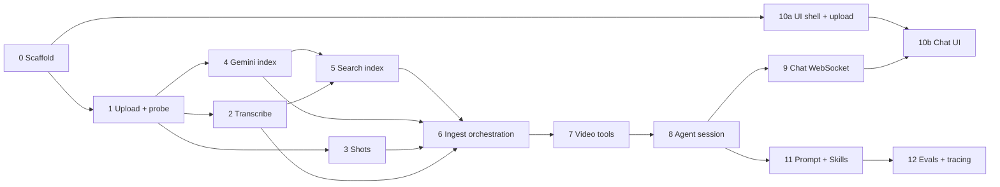

# Implementation and Test Plan (v1: Q&A)

This plan implements [DESIGN.md](DESIGN.md) v1. The v1 scope is:

- Upload one video, up to 60 minutes and mainly English.
- Ingest it with ElevenLabs Scribe v2, PySceneDetect and `gemini-3.8-flash`.
- Chat with an Opus 5.5 agent through the Claude Agent SDK.
- Answers must carry `[mm:ss]` citations.

Editing is out of scope for v1.

## How the work is split

The work is 13 steps, grouped into 5 milestones.

- **One step = one worktree = one PR.** Each step gets its own worktree, `claude --worktree <step-slug>`, and merges to `main` by PR. This follows [CLAUDE.md](CLAUDE.md).
- **Each step ships with its own tests and a "done when" check.** When a step merges, `main` is still runnable.
- **Steps on the same row of the graph below can run in parallel worktrees.**

| Milestone | Steps | What you can do when it lands |
|---|---|---|
| **M1: Upload and play** | 0, 1, 10a | Drop in a video, see it validated and playing in the browser |
| **M2: Ingest** | 2–6 | Each upload produces a transcript, shots, captions, an overview and a search index, with per-step progress |
| **M3: Agent** | 7–9 | Chat with the agent about the video over the WebSocket, or from a CLI |
| **M4: Full UI** | 10b, 11 | The full chat UI with clickable timestamp chips, folded tool calls, Stop, and Skills |
| **M5: Quality gate** | 12 | An eval set with a pass/fail gate, and a Langfuse trace per turn |

## Test strategy

There are four layers. Only the first runs in CI.

1. **Offline unit and integration tests (pytest, vitest).** These are the default and need no API keys.
   - Providers sit behind small interfaces: `Transcriber`, `VisionModel` and `AgentClient`.
   - Tests use fakes, or replay recorded JSON responses from `tests/fixtures/`.
2. **Live tests (`pytest -m live`).** These call the real ElevenLabs, Gemini and Anthropic APIs with keys from `.env`.
   - Run them by hand before merging any step that touches a provider.
   - Each run re-records the fixtures that layer 1 replays, so the fakes stay faithful to the real responses.
3. **Browser end-to-end tests (Playwright).** These drive the real UI against the real server, with a stub agent and stub providers.
   - Start the stubs with `HARNESS_FAKE_PROVIDERS=1`.
   - The tests are deterministic and cost nothing.
4. **Evals (`make eval`).** The real pipeline answers a fixed question set, and the run is scored and gated (step 12).

**Test media** lives in `tests/media/`, is under 2 MB in total, and is committed:

| File | Made with | Contents |
|---|---|---|
| `cuts.mp4` | ffmpeg `testsrc` and color clips concatenated | 4 hard cuts at known frames, no speech |
| `speech.mp4` | macOS `say` over a color background, two voices | 30 s, with known words at known times |
| `long_header.mp4` | ffmpeg | A 61-minute video at 1×1 px and 1 fps, a few KB, for testing the length cap |

**CI** is a GitHub Actions workflow that runs `ruff`, `pytest -m "not live"`, `vitest` and Playwright on each PR, with ffmpeg installed.

---

## Step 0: Scaffold and tooling

- **Server:**
  - The `server/` package managed with `uv`: FastAPI app factory, `GET /health`, `pydantic-settings` config, and `release.json` loading.
  - `release.json` holds the model IDs, prompt version and budgets.
- **Front end:** the `web/` Vite + React + TypeScript + Tailwind app.
- **Repo files:**
  - `.env.example` with the three API keys.
  - A `Makefile` with `dev`, `test`, `test-live`, `e2e`, `eval` and `lint`.
  - The CI workflow.
- **Provider interfaces:** the empty `Transcriber`, `VisionModel` and `AgentClient` protocols, plus a fakes module.
- **Tests:**
  - `/health` returns 200.
  - The config loads `release.json`, and a missing key fails with a clear message.
  - A vitest smoke test renders the app.
- **Done when:** `make dev` serves the API and UI, and CI is green on the PR.

## Step 1: Upload, probe and workspace

- **`POST /video`:**
  - Chunked upload saved to `workspace/<id>/source.<ext>`.
  - `ffprobe` writes `meta.json`.
  - Uploads over 60 minutes, without a video stream, or in an unsupported container are rejected with a 4xx and a reason.
- **One video at a time:** a new upload deletes the previous workspace and resets `current_video`.
- **Proxy and thumbnails:**
  - A 720p H.264 proxy (`proxy.mp4`).
  - A thumbnail every 2 s in `thumbs/`.
  - `GET /video/current/proxy` supports HTTP range requests, so the player can seek.
- **Tests:**
  - Uploading `speech.mp4` gives the right `meta.json`.
  - `long_header.mp4` is rejected with "longer than 60 minutes".
  - A second upload replaces the first.
  - A range request returns 206.
  - The proxy's duration matches the source to within 0.1 s.
- **Done when:** curl can upload a video and a browser can play the proxy.

## Step 2: Transcription (ElevenLabs Scribe v2)

- **`ingest/scribe.py`:**
  - Sends the source file to `speech_to_text.convert` with `model_id=scribe_v2`, `diarize=True`, `tag_audio_events=True`, `timestamps_granularity="word"`, and `language_code=None` so the language is detected.
  - Retries with backoff on 429 and 5xx responses.
- **Segments:** words are grouped into sentence segments, splitting on punctuation, on a speaker change, or on a pause over 0.8 s.
- **Output:** `transcript.json`, with `language`, `speakers`, `words[]` and `segments[]`, each item carrying `start`, `end`, `speaker` and `text`.
- **Tests:**
  - Replay a recorded Scribe response, then check that segmenting is correct and that word times only ever increase.
  - Check the speaker-change split.
  - Check that audio events are kept but excluded from segment text.
  - Live: transcribe `speech.mp4`. The known words should appear within ±0.3 s of their known times, with 2 speakers.
- **Done when:** running `python -m server.ingest.scribe <file>` writes a correct `transcript.json`.

## Step 3: Shot detection

- **Detection:** PySceneDetect `ContentDetector`.
- **Clean-up:** shots shorter than 1 s are merged into a neighbour, and shots longer than 30 s are split evenly.
- **Output:** `shots.json`, with `id`, `start`, `end` and `thumb` per shot.
- **Tests:**
  - On `cuts.mp4`, the 4 cuts are found within ±1 frame.
  - The merge and split rules get unit tests on synthetic boundary lists.
  - The shots cover the whole duration with no gaps or overlaps.
- **Done when:** `shots.json` is correct on the test media.

## Step 4: Gemini indexing

- **Upload:** `ingest/gemini_index.py` uploads the source with `client.files.upload`, polls until the file is `ACTIVE`, and stores the `uri` and expiry in `gemini_file.json`.
- **Re-upload:** `ensure_active()` uploads again if the file is within 1 h of its 48 h expiry.
- **Captioning:**
  - One captioning call to `gemini-3.8-flash` with schema-constrained JSON output.
  - The prompt includes the shot list and transcript segments.
  - It returns `captions.json`, with a caption, on-screen text, entities and action for each shot.
  - It also returns `overview.json`, with a summary and a subject registry.
- **Long videos:** for videos over about 20 minutes, captioning runs in windows using `start_offset` and `end_offset`, and the results are merged.
- **Tests:**
  - With the fake `VisionModel`: the output validates against the schema, every shot id is covered, a windowed run merges correctly, and expiry triggers a re-upload.
  - Live: run on `speech.mp4` and `cuts.mp4`. The output should validate, and each colour clip in `cuts.mp4` should be described as that colour.
- **Done when:** captions and the overview exist and validate for the test media.

## Step 5: Search index

- **Index:** SQLite FTS5 in `index.sqlite`, holding transcript segments and shot captions plus on-screen text. Each row carries `kind`, `start`, `end`, `shot_id` and `text`.
- **Search:** `search(query, k)` returns hits ranked by BM25, with times and snippets.
- **Tests:**
  - A word known to be in `speech.mp4` returns the right segment at the right time.
  - A caption-only term returns a `kind=caption` hit.
  - An empty query is handled gracefully.
- **Done when:** search returns correct, time-stamped hits on the test media.

## Step 6: Ingest orchestration and status

- **Pipeline:** after an upload, `ingest/pipeline.py` runs these steps:
  1. Steps 2, 3 and 4 run in parallel.
  2. Step 5 runs once the transcript and captions are both ready.
- **Status:**
  - Each step's state is written to `status.json`: pending, running, done or failed, with an error message on failure.
  - The state is streamed as `ingest_status` events.
- **Partial readiness:**
  - The video is "chat-ready" once the transcript and overview are done.
  - Captions can still be finishing in the background.
  - If one step fails, the others still finish, and that step can be retried with `POST /video/current/retry/<step>`.
- **Tests:**
  - All steps run with fakes: the event order is correct and the final `status.json` is correct.
  - The Gemini fake fails: the transcript still finishes, and a retry recovers.
  - The chat-ready flag flips at the right moment.
- **Done when:** one upload produces the whole workspace, and progress is visible over `GET /video/current/status`.

## Step 7: Video tools (in-process MCP server)

- **`agent/tools.py`:** six tools built with `@tool` and `create_sdk_mcp_server(name="video")`.
  - `get_overview`, `search`, `get_transcript`, `list_shots`: read the workspace.
  - `inspect(question, start, end, fps?)`: calls Gemini on a time range and returns timestamped JSON.
  - `get_frames(timestamps[])`: returns base64 JPEGs taken from the proxy.
- **Design rules:**
  - Each tool is a plain function first, with a thin MCP wrapper over it, so the functions can be tested without the SDK.
  - The tools return JSON as text, because Python `@tool` drops `structuredContent`.
- **Caching:**
  - `inspect` results are cached on disk by hash of (start, end, fps, question).
  - A Gemini context cache of the video is created once per session, and repeat calls pass it as `cached_content`.
- **Guards:**
  - Time ranges are clamped to the video's duration.
  - `get_frames` takes at most 8 timestamps.
  - `inspect` is limited to N calls per session, set in `release.json`.
- **Tests:**
  - Each function runs against a prepared workspace fixture.
  - Clamping and the limits work.
  - A second identical `inspect` call is a cache hit with no fake call.
  - `get_frames` returns valid JPEGs.
  - Live: `inspect` on `cuts.mp4` between 00:02 and 00:04 names the right colour.
- **Done when:** all six tools work when called directly and through the MCP server.

## Step 8: Agent session

- **`agent/session.py`:** owns one `ClaudeSDKClient` for the current video, configured as in DESIGN.md §5:
  - `model` comes from `release.json`, which defaults to Opus 5.5.
  - Tool settings: `mcp_servers={"video": ...}`, an explicit `allowed_tools` list, and Bash and web tools in `disallowed_tools`.
  - Permissions and limits: `permission_mode="dontAsk"`, `max_budget_usd` and `max_turns`.
  - `include_partial_messages=True`, so replies stream token by token.
- **Lifecycle:**
  - `start(video_id)`.
  - `send(text)`: an async iterator over the SDK's messages.
  - `interrupt()`.
  - `resume`: uses the `session_id` stored in `session.json`.
  - A new upload closes the old session.
- **First system prompt:** `agent/prompt.v1.md`, with the grounding rule. Step 11 refines it.
- **CLI:** `python -m server.agent chat` lets you chat with the current video from the terminal, before the UI exists.
- **Tests:**
  - **Offline:** using a stub `AgentClient`, check the lifecycle, check that resume picks up the stored id, and check that a new upload closes the old session.
  - **Live smoke:** on `speech.mp4`, asking "what does the second speaker say first?" must call `search` or `get_transcript`, and the answer must contain a `[mm:ss]` within ±3 s of the truth.
  - **Live, permissions:** asking it to "run ls" produces no Bash tool call.
- **Done when:** the CLI chat answers grounded questions about the uploaded video.

## Step 9: Chat WebSocket and protocol

- **Endpoint:** `WS /chat`.
- **Frames from the client:** `user_message` and `interrupt`.
- **Frames from the server:**
  - `text_delta`, mapped from `StreamEvent` `content_block_delta`.
  - `tool_use` and `tool_result`, each with a one-line summary.
  - `result`, with the cost and the session id.
  - `ingest_status` and `error`.
- **Contract:** the frame types are defined once as pydantic models and exported to `web/src/protocol.ts`, so the server and UI share one definition.
- **Rules:**
  - Messages are refused with an error frame until the video is chat-ready.
  - A single WebSocket connection is allowed; a second tab gets an explanation.
- **Tests:**
  - Use the FastAPI TestClient with a stub agent that emits a scripted stream.
  - Check frame order and shapes, that `interrupt` stops the stream, the refusal before chat-ready, and the error frame when the agent throws.
  - A schema snapshot test checks that the exported TypeScript matches the pydantic models.
- **Done when:** `websocat`, or a test, can hold a full streamed conversation.

## Step 10a: UI shell and upload (can start right after step 0)

- **Layout** as in DESIGN.md §6.
- **Upload area:** a single-file drop zone with a progress bar. Replacing the video asks for confirmation.
- **Player:** a `<video>` element showing the proxy.
- **Ingest panel:** shows progress for each step from `ingest_status`.
- **Shot strip:** thumbnails that seek the player when clicked.
- **Transcript panel:** coloured by speaker, highlights the current word as the video plays, and seeks when a word is clicked.
- **Tests:**
  - vitest checks that the transcript finds the right word for a given `currentTime`, and that clicking seeks.
  - Playwright, with fake providers: upload `speech.mp4`, watch the ingest steps reach "done", click a transcript word, and confirm `video.currentTime` lands within 0.2 s.
- **Done when:** M1 and the visible half of M2 can be demoed in the browser.

## Step 10b: Chat UI

- **Chat panel:** connected to `WS /chat`.
- **Streaming:** text renders as it arrives.
- **Timestamp chips:** `[mm:ss]` and `[mm:ss–mm:ss]` become chips that seek the player.
- **Tool calls:** shown as folded rows that expand to show inputs and outputs.
- **Controls:** a Stop button sends `interrupt`. The input stays disabled until the video is chat-ready.
- **Reload:** the conversation is restored from the resumed session.
- **Tests:**
  - vitest checks that the chip parser handles ranges, `h:mm:ss` and malformed text.
  - Playwright, with the stub agent, checks:
    - a streamed answer renders;
    - clicking a chip seeks the player;
    - Stop ends the stream;
    - after a reload the history is still there.
- **Done when:** M3 can be done entirely in the browser.

## Step 11: Prompt and Skills

- **`prompt.v2.md`:**
  - The grounding rule.
  - A coarse-to-fine tool strategy: overview, then search or transcript, then inspect or frames.
  - When unsure, inspect before answering.
  - Say so when the video doesn't contain the answer.
- **Skills:** `summarize-video` and `find-moments`, under `.claude/skills/`, loaded through `setting_sources=["project"]`.
- **Tests:**
  - A live A/B comparison of v1 and v2 on the eval subset from step 12.
  - A Skill must be loaded for "summarize this video".
- **Done when:** v2 scores at least as well as v1 on the eval subset.

## Step 12: Evals and tracing

- **Eval set:** about 30 questions over 3–4 reference videos in `evals/dataset.jsonl`. Each item has a question, a gold answer, a gold time range, and a type:

  | Type | Example |
  |---|---|
  | Transcript | "What did she say about pricing?" |
  | Visual | "What colour is the car?" |
  | Localisation | "When does he open the laptop?" |
  | Counting | "How many people are on stage?" |
  | Absent | Asks about something not in the video |

- **Scoring:**
  - **Timestamp hit:** a code check that the cited time is within ±3 s of the gold range.
  - **Answer quality:** a Haiku judge scores 1–5.
  - **Absent questions:** the agent passes only if it says the answer isn't in the video.
  - **Cost:** cost per question, from `result`.
- **Gate:** `make eval` exits 1 unless the timestamp hit rate is at least 80% and the mean judge score is at least 3.5, as in `agent-harness`. Results go to `evals/results/<release>.json`.
- **Tracing:** Langfuse records one trace per chat turn, covering:
  - the SDK messages;
  - the tool calls, with timings;
  - the Gemini and ElevenLabs calls, with latency and cost.

  The `release.json` hash is stamped on every trace.
- **Tests:**
  - The scoring functions get unit tests on canned answers.
  - A gate test checks both the pass and the fail path.
- **Done when:** `make eval` prints a scorecard and gates, and traces show up in Langfuse.

---

## Final acceptance (v1 done)

1. Upload a real 30–60 minute English video. Ingest finishes, and `status.json` shows every step done.
2. Ask 10 mixed questions in the browser. Each answer cites clickable timestamps that land on the right moment.
3. Upload a 61-minute video. It is rejected with a clear message.
4. `make eval` passes the gate. CI is green on `main`.
5. Record the cost of one full session, ingest plus 10 questions, in the README.

## Open items before starting

- **Reference videos for evals:** use 3–4 of your own videos, or Creative Commons talks or tutorials. The questions need gold answers written by hand.
- **Langfuse:** reuse your agent-harness Langfuse project, or create a new one.
