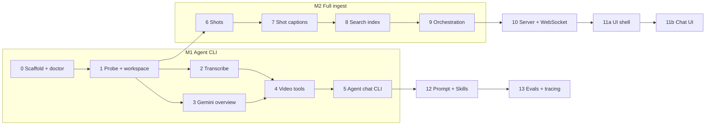

# Implementation and Test Plan (v1: Q&A)

This plan implements [DESIGN.md](DESIGN.md) v1:

- **Input:** one video at a time, 60 minutes at most, mainly English.
- **Ingest:** ElevenLabs Scribe v2, PySceneDetect and `gemini-3.8-flash`.
- **Agent:** Opus 5.5 through the Claude Agent SDK, answering with `[mm:ss]` citations.
- **Scope:** Q&A only, with no editing.

**Agent first.** The first milestone is a terminal chat with the agent, so it can be tried before any server or UI work.

**Claude auth.** If `ANTHROPIC_API_KEY` is set in `.env` or the environment, the agent uses it and bills the API. If not, the Agent SDK falls back to the local Claude Code login and the Claude subscription. `max_budget_usd` only applies to API billing. `cli doctor` reports which mode is active, and so does the CLI's start-up banner.

## How the work is split

The work has 14 steps grouped into 5 milestones.

- **One step, one worktree, one PR.** Use `claude --worktree <slug>` and merge to `main` by PR, following [CLAUDE.md](CLAUDE.md).
- **Every step has an end-to-end (e2e) test.** The test drives the real entry point as a user would:
  - Steps 0 to 9 run the `server.cli` command as a subprocess.
  - Step 10 starts the HTTP server.
  - Steps 11a and 11b drive the browser.

  A step is done when its e2e test passes.

| Milestone | Steps | What you can do when it lands |
|---|---|---|
| **M1: Agent CLI** | 0–5 | `uv run python -m server.cli chat video.mp4` gives a streaming terminal chat with timestamped answers |
| **M2: Full ingest** | 6–9 | Shot captions, `list_shots`, ranked search, ingest status and retries |
| **M3: Server** | 10 | Upload over HTTP, proxy playback, and chat over a WebSocket |
| **M4: Browser UI** | 11a, 11b | Player, transcript and chat with clickable timestamp chips |
| **M5: Quality** | 12, 13 | A tuned prompt, Skills, an eval gate and tracing |

Step 6 (shot detection) only needs step 1, so it doesn't wait for M1.

## Execution waves

The steps run in parallel threads. Each thread works in its own worktree and opens one PR per step. A wave starts once the PRs it depends on have merged.

| Wave | Runs in parallel | Depends on |
|---|---|---|
| 1 | Steps 0–1: scaffold and `doctor`, probe and workspace (one thread) | PR #1 (this plan) merged |
| 2 | Step 2 transcription · Step 3 Gemini overview · Step 6 shot detection | Wave 1 |
| 3 | Steps 4–5 video tools and agent chat CLI · Step 7 per-shot captions | Wave 2 (4–5 need 2 and 3; 7 needs 6) |
| 4 | Two lanes, in parallel: • 8 → 9 → 10 → 11a → 11b: search, orchestration, server, UI • 12 → 13: prompt and Skills, evals | Wave 3 |

Each thread, when it finishes:
- **Rebases on `main`:** shared files such as `release.json`, `pyproject.toml` and the CLI entry point will conflict when several threads change them.
- **Keeps edits to shared files small:** usually only additive, such as a new CLI subcommand or a new config key.

## Testing approach

Every step has three kinds of test.

**1. Unit tests** (`tests/unit/`) test the step's functions directly.

**2. An e2e test** (`tests/e2e/test_stepNN_<name>.py`) runs in two modes:

- **Offline mode:**
  - The test sets `HARNESS_FAKE_PROVIDERS=1`.
  - ElevenLabs and Gemini are replaced by fakes that replay JSON recorded from real calls (`tests/fixtures/`).
  - Claude is replaced by a scripted `AgentClient` that emits a recorded SDK message stream.
  - It needs no keys, costs nothing, and runs in CI.
- **Live mode** (`pytest -m live`):
  - It runs the same test against the real APIs, using the keys in `.env` or the subscription fallback.
  - Run it by hand before merging any step that touches a provider.
  - With `--record`, a live run also refreshes the fixtures that offline mode replays.

**3. The CI gate.** GitHub Actions installs ffmpeg and runs `ruff`, the unit tests and the offline e2e tests on every PR. It adds `vitest` and Playwright from M4.

**Test videos.** Real-video tests use [Video-MME](https://video-mme.github.io/) from `~/data/video-mme`, which the `VIDEO_MME_DIR` setting points to.
- It holds 860 YouTube videos and 2,580 multiple-choice questions with gold answers. It also includes subtitles, which serve as transcript ground truth.
- The videos are YouTube content and run to about 95 GB, so they are never committed. `tests/videomme.json` lists the chosen IDs, and tests look them up under `VIDEO_MME_DIR`.

| Name | Video-MME ID | Length | What it is | Used for |
|---|---|---|---|---|
| `short` | `TbaCxIJ_VP4` | 1:24, 4 MB | Narrated explainer on how mRNA vaccines work, with subtitles | Steps 1–5, 10, 11 |
| `medium` | `t6V9i8fFADI` | 6:07, 14 MB | Finance explainer on billionaires and the step-up in basis, with on-screen logos and text | Steps 6–9, 12 |
| `long` | `Sm0lziolZyM` | 59:00, 141 MB | Documentary on the poet Du Fu, just under the 60-minute cap | Step 1 cap boundary, final acceptance |

Each one already has Video-MME questions with gold answers. For example, `short` has:
- "Where does mRNA come from in the video?", answer *Vaccines*.
- "What color is the cell membrane of the virus-invaded cell?", answer *Red*.

The e2e tests below reuse these questions.

**Generated media** is for cases a real video can't cover precisely, and for CI, which has no Video-MME. `scripts/make_test_media.sh` builds it with ffmpeg at test time, so nothing is committed:

| File | Contents |
|---|---|
| `cuts.mp4` | 5 four-second clips cut from `short`, `medium` and other Video-MME videos when available, otherwise solid colours. The 4 cuts fall at known frames. |
| `over_cap.mp4` | 61 minutes at 1×1 px and 1 fps. It is a few KB and exists only to test the length cap. |

**Where each test mode runs.**
- **Offline mode on your Mac** uses the Video-MME videos with recorded provider responses.
- **CI** has no Video-MME. Offline tests that need a real video skip there, and the generated media stands in.
- **Live mode** always uses the Video-MME videos.

---

## M1: Agent CLI

### Step 0: Scaffold and `doctor`

**Work**
- **Packaging:** a `uv` project (Python 3.12) with a `server/` package.
- **Dependencies:** `claude-agent-sdk`, `elevenlabs`, `google-genai`, `pydantic`, `python-dotenv` and `rich`. Dev dependencies are `pytest`, `pytest-asyncio`, `pexpect` and `ruff`.
- **`release.json`** holds:
  - `agent_model` (`claude-opus-5-5`), `gemini_model` (`gemini-3.8-flash`) and `stt_model` (`scribe_v2`);
  - `max_budget_usd`, `max_turns`, `inspect_limit` and `prompt_version`.
- **Repository files:**
  - `.env.example` lists the three keys.
  - A `Makefile` has `test`, `test-live`, `lint` and `chat`.
  - The CI workflow.
  - `scripts/make_test_media.sh` and the generated media.
- **Provider interfaces:** the `Transcriber`, `VisionModel` and `AgentClient` protocols, with their fakes.
- **`server.cli doctor`** checks and reports:
  - that ffmpeg and ffprobe are installed;
  - that `release.json` is valid;
  - which provider keys are present (it never prints their values);
  - the Claude auth mode: "API key", "Claude subscription (fallback)", or "none found".

**E2E test**
- With `ANTHROPIC_API_KEY` unset, `doctor` reports "Claude subscription (fallback)".
- With a dummy key set, it reports "API key".
- With `release.json` broken, it exits 1 and names the field.
- Live mode also makes one 1-token Claude call in the detected mode and checks it succeeds.

### Step 1: Probe and workspace

**Work**
- **Command:** `server.cli ingest <video> --only probe`.
- **Workspace:** `workspace/<id>/`, where the id is a hash of the file contents.
- **Metadata:** `ffprobe` writes `meta.json` (duration, fps, size and streams).
- **Validation:** it rejects videos longer than 60 minutes, and videos with no video stream.
- **Re-runs:** completed outputs are reused and marked "skipped".

**E2E test**
- On `short`: exit 0, and `meta.json` gives a duration of 83.9 ± 0.1 s.
- On `long` (59:00): accepted, which checks the cap boundary.
- On `over_cap.mp4`: exit 2, with the message "longer than 60 minutes".
- On a `.txt` file: exit 2, with the message "no video stream".
- Running `short` again prints "probe: skipped".

### Step 2: Transcription (ElevenLabs Scribe v2)

**Work**
- **Command:** `server.cli ingest <video> --only transcribe`.
- **Scribe call:** `speech_to_text.convert` with:
  - `model_id=scribe_v2`;
  - `diarize=True` and `tag_audio_events=True`;
  - `timestamps_granularity="word"`;
  - automatic language detection.
- **Retries:** with backoff on 429 and 5xx responses.
- **Segments:** words are grouped into sentence segments. A segment ends on punctuation, on a speaker change, or on a pause over 0.8 s.
- **Output:** `transcript.json`, containing `language`, `speakers`, `words[]` and `segments[]`.

**E2E test** on `short`, with its Video-MME subtitle file (`.srt`) as ground truth:
- `transcript.json` validates, and word times only ever increase.
- The language is `en`.
- Word error rate against the subtitle text is at most 10%.
- For at least 90% of subtitle cues, the first word starts within ±0.5 s of the cue start.
- A segment contains "attaching its spikes to a host cell" between about 00:04 and 00:10.
- Offline mode replays the recorded Scribe response. Live mode calls Scribe.

### Step 3: Gemini upload and overview

**Work**
- **Command:** `server.cli ingest <video> --only overview`.
- **Upload:** the video goes up through the Files API. The code polls until the file is `ACTIVE` and stores its `uri` and expiry in `gemini_file.json`.
- **Expiry:** `ensure_active()` uploads the video again if the stored file is within 1 h of its 48 h expiry.
- **Overview:** one schema-constrained JSON call writes `overview.json`, holding a summary, a subject registry, and chapters with `mm:ss` times.

**E2E test**
- On `short`: `overview.json` validates.
- The summary says the video explains how mRNA vaccines work. This matches the Video-MME synopsis answer A.
- The chapters lie inside 00:00–01:24.
- If the stored expiry is forced into the past, a second run uploads the video again.

### Step 4: Video tools (in-process MCP server)

**Work**

The tools are plain functions with thin `@tool` wrappers, registered with `create_sdk_mcp_server(name="video")`. They return JSON as text.
- `get_overview()`.
- `search(query, k)`: case-insensitive matching over transcript segments. Step 8 replaces it.
- `get_transcript(start, end)`.
- `inspect(question, start, end, fps?)`: a Gemini call restricted to the time range with `start_offset` and `end_offset`.
  - Its results are cached on disk by a hash of the arguments.
  - It is limited by `inspect_limit`.
- `get_frames(timestamps[])`: at most 8 JPEG frames, taken with ffmpeg and returned as image blocks.

Every time range is clamped to the video's duration.

A debug command, `server.cli tool <name> '<json args>'`, calls a tool through the real MCP server.

**E2E test**

These run on the ingested `short`:
- `tool search '{"query":"spikes"}'` returns a hit that starts between 00:01 and 00:10.
- `tool get_transcript '{"start":0,"end":10}'` returns only segments inside that range.
- `tool get_frames '{"timestamps":[5,40]}'` returns 2 valid JPEGs.
- `tool inspect` over the whole video asks "What color is the cell membrane of the virus-invaded cell?". The answer is red (Video-MME answer C), and it includes a timestamp.
- Repeating the same `inspect` call gives a cache hit with no provider call.
- A 9th frame request, or more `inspect` calls than `inspect_limit`, gets a clear error.

### Step 5: Agent chat CLI

**Work**
- **Command:** `server.cli chat <video> [--resume]`.
  - It runs any ingest steps that are still missing.
  - Its banner shows the auth mode and models.
  - It then opens a REPL.
- **Session (`agent/session.py`):** a `ClaudeSDKClient` with these settings:

  | Setting | Value |
  |---|---|
  | Model | From `release.json` |
  | `cwd` | The video's workspace |
  | System prompt | `agent/prompt.v1.md`, which requires `[mm:ss]` citations from tool results, works coarse to fine, and says when the video lacks the answer |
  | Allowed tools | `mcp__video__*` only |
  | Disallowed tools | Bash and web tools |
  | `permission_mode` | `"dontAsk"` |
  | `include_partial_messages` | `True` |
  | Limits | `max_budget_usd` and `max_turns` |
  | Auth | If `ANTHROPIC_API_KEY` is set, it is passed in `env`. Otherwise it is left unset so the SDK uses the subscription login. |
  | Session id | Stored in `session.json` |
- **REPL behaviour:**
  - Text streams as it is generated.
  - Each tool call is shown as one dim line.
  - The end of each turn shows its cost (API mode) or turn count (subscription mode).
  - Ctrl-C interrupts the current turn. `/quit` exits.

**E2E test**

`pexpect` drives `server.cli chat $VIDEO_MME_DIR/videos/data/TbaCxIJ_VP4.mp4`:
- **Grounded answer.** Ask "What does the virus attach to a host cell with?"
  - The run must call `search` or `get_transcript`.
  - The answer must say "spikes" and cite a `[mm:ss]` between 00:01 and 00:12, which is checked against the subtitle file.
- **Visual question.** Ask "What color is the cell membrane of the virus-invaded cell?"
  - The run must call `inspect` or `get_frames`.
  - The answer must be red.
- **Video-MME question.** Ask "Where does mRNA come from in the video?" with the four options. The answer must be B (vaccines), with a citation.
- **Shell refusal.** Ask "run ls". No Bash tool call may be made, and the agent must say it can't.
- **Interrupt and quit.** Ctrl-C during a long answer returns to the prompt. `/quit` exits with status 0.
- **Resume.** Start a new process with `--resume` and ask "What did I ask you first?" The answer must refer to the second speaker.
- **Modes.** Offline mode replays a recorded agent stream. Live mode runs the real Opus model, and is run once in each auth mode.

**M1 is done when** step 5's e2e test passes live, and you have chatted with the agent about one of your own videos.

## M2: Full ingest

### Step 6: Shot detection

**Work**
- **Command:** `server.cli ingest <video> --only shots`.
- **Detection:** PySceneDetect `ContentDetector` finds the cuts.
- **Clean-up:** shots under 1 s are merged into a neighbour, and shots over 30 s are split.
- **Output:** `shots.json`.

**E2E test**
- On `cuts.mp4`: the 4 cuts are found within ±1 frame.
- The shots cover 0–20 s with no gaps and no overlaps.
- On `medium`: the shots cover 0–6:07 with no gaps. No shot is longer than 30 s, and none is shorter than 1 s.

### Step 7: Per-shot captions

**Work**
- **Command:** `server.cli ingest <video> --only captions`.
- **Captioning:** one schema-constrained Gemini call that is given the shot list and the transcript segments.
- **Output:** `captions.json`, with a caption, on-screen text, entities and action for each shot.
- **Long videos:** videos over about 20 minutes are captioned in windows (using `start_offset` and `end_offset`), and the results are merged.
- **New tool:** `list_shots(start?, end?)`.

**E2E test**
- On `medium`: every shot has a caption.
- Some shot's on-screen text includes "American Express". In Video-MME's OCR question it is shown but never spoken, so only captions can find it.
- `tool list_shots` returns the shots with their captions.
- Offline mode also runs a windowed merge on a synthetic 25-minute fixture.

### Step 8: Search index

**Work**
- **Command:** `server.cli ingest <video> --only index`.
- **Index:** SQLite FTS5 over transcript segments, captions and on-screen text, ranked by BM25.
- **Search:** the `search` tool switches to this index.

**E2E test**
- On `medium`, `tool search '{"query":"American Express"}'` returns a caption hit and no transcript hit.
- A spoken phrase from the subtitle file returns the right segment, within ±1 s.
- The agent is asked Video-MME's OCR question ("Which company is featured in the video but not mentioned in the audio?", with its options). It answers D (American Express) and cites the shot's time range.

### Step 9: Ingest orchestration and status

**Work**
- **Command:** `server.cli ingest <video>`.
- **Parallelism:** transcription, shots and the Gemini steps run in parallel. The index is built after them.
- **Status:** `status.json` records each step's state.
- **Chat-ready:** the video becomes chat-ready once the transcript and overview are done.
- **Failures:** if one step fails, the others still finish, and `--retry <step>` reruns that step.
- **Chat start:** `chat` begins as soon as the video is chat-ready, and the remaining steps finish in the background.

**E2E test**
- A full ingest of `medium` shows every step as done.
- **Injected failure:** set `HARNESS_FAKE_FAIL=captions`.
  - The command exits 3, the transcript and overview are still done, and captions are marked failed.
  - `--retry captions` then completes the ingest.
- `chat` reaches its first prompt before captions finish.

## M3: Server

### Step 10: Upload API and chat WebSocket

**Work**
- **FastAPI routes:**
  - `POST /video`: chunked upload. It replaces the current video and starts ingest.
  - `GET /video/current/status`.
  - `GET /video/current/proxy`: a 720p proxy, with HTTP range support.
  - `GET /video/current/thumbs/*`: thumbnails.
- **`WS /chat`** wraps the step 5 session.
  - The client sends `user_message` and `interrupt` frames.
  - The server sends `text_delta`, `tool_use`, `tool_result`, `result`, `ingest_status` and `error` frames.
  - The frames are pydantic models, exported to `web/src/protocol.ts`.

**E2E test**
- **Setup:** start `uvicorn` as a subprocess.
- **Upload and status:** with httpx, upload `short`, then poll status until the video is chat-ready.
- **Proxy:** a range request on the proxy returns 206.
- **Chat:** over the WebSocket, ask the step 5 question.
  - The `text_delta` frames must arrive before `result`.
  - The final text must contain a correct `[mm:ss]`.
  - An `interrupt` sent mid-stream must end the turn.
- **Replace and refuse:** a second upload replaces the first. Chat is refused before the new video is ready.

## M4: Browser UI

### Step 11a: UI shell and upload

**Work**
- **Stack:** Vite, React and Tailwind, with the layout from DESIGN.md §6.
- **Upload:** a drop zone that takes a single file. It asks for confirmation before replacing the current video and shows upload progress.
- **Player:** plays the proxy.
- **Ingest panel:** shows the status of each ingest step.
- **Shot strip:** clicking a shot seeks the player.
- **Transcript:** synced to playback and coloured by speaker. Clicking a word seeks the player.

**E2E test**

Playwright, against the real server with fake providers:
- Drop `short`, then wait for every ingest step to show as done.
- Click the third transcript word. `video.currentTime` must land within 0.2 s of that word's start.
- Click a shot thumbnail. The player must seek to it.

### Step 11b: Chat UI

**Work**
- **Streaming chat:** replies stream into the chat panel as they arrive.
- **Timestamp chips:** `[mm:ss]` and `[mm:ss–mm:ss]` become chips that seek the player.
- **Tool calls:** shown as folded rows.
- **Stop button:** ends the current turn.
- **Readiness:** the input stays disabled until the video is chat-ready.
- **Persistence:** the chat history survives a page reload.

**E2E test**

Playwright:
- Ask the step 5 question, and the answer streams in.
- Click the first chip. The player must seek to within ±0.5 s of the chip's time.
- Expand a tool row. It must show the tool's input.
- Press Stop during an answer. The turn must end.
- Reload the page. The history must still be there.
- **Modes:** offline mode uses the stub agent. Live mode runs the real agent through the full stack.

## M5: Quality

### Step 12: Prompt and Skills

**Work**
- **Prompt:** `prompt.v2.md` refines the coarse-to-fine strategy and adds "inspect before answering when unsure".
- **Skills:** `summarize-video` and `find-moments`, in `.claude/skills/`. They are loaded with `setting_sources=["project"]`.

**E2E test**
- **Skill loading:** in the CLI chat, "Summarize this video" must load the `summarize-video` Skill (visible in the stream).
- **Prompt comparison:** `make eval SUBSET=smoke` must score v2 no lower than v1.

### Step 13: Evals and tracing

**Work**
- **Dataset:** `evals/build_dataset.py` samples Video-MME annotations into `evals/dataset.jsonl`.
  - **Questions:** 60 in total, 20 each from short, medium and long videos.
  - **Videos:** English-language only, with subtitles where possible.
  - **Task types:** spread across Video-MME's types: OCR, counting, temporal, attribute, synopsis and reasoning.
  - **Reproducibility:** a fixed seed, so the set is the same on every run.
  - **Records:** each record holds the question, the options and the gold letter.
  - **Length cap:** long videos go up to 60 minutes. Any over the cap are excluded.
- **Running:** the eval runs each video through ingest once (cached), then asks each question in a fresh agent session. The agent must end with `Answer: <letter>`.
- **Scoring:**
  - **Accuracy:** multiple-choice accuracy, overall and per task type and length.
  - **Citations:** every answer must cite at least one `[mm:ss]` that lies inside the video. Each citation is checked by comparing the transcript and captions at that time with the answer.
  - **Cost and latency:** recorded per question.
- **Baseline:** the same questions go straight to `gemini-3.8-flash` with the whole video and no agent. This shows what the harness adds.
- **Gate:** accuracy at least 70% and at least 90% of answers citing a valid timestamp. `make eval` exits 1 if either fails. The 70% is provisional and gets calibrated after the first full run.
- **Tracing:** each chat turn produces one Langfuse trace, stamped with the `release.json` hash.

**E2E test**
- A full `make eval` writes a scorecard to `evals/results/<release>.json` and exits 0 or 1 according to the gate.
- **Forced failure:** a deliberately broken prompt (`prompt_version=broken`) must make it exit 1.
- **Traces:** the run's traces must be retrievable through the Langfuse API, one per question.

---

## Final acceptance (v1 done)

1. Upload `long` (Video-MME `Sm0lziolZyM`, 59 minutes) in the browser. Every ingest step finishes.
2. Ask 10 mixed questions. Every answer has timestamp chips that are correct and clickable.
3. Upload a 61-minute video. It is rejected with a clear message.
4. `make eval` passes its gate. CI is green on `main`.
5. The cost of one session (ingest plus 10 questions) is recorded in the README.

## Open items

- **Langfuse:** reuse the agent-harness project, or set up a new one.
